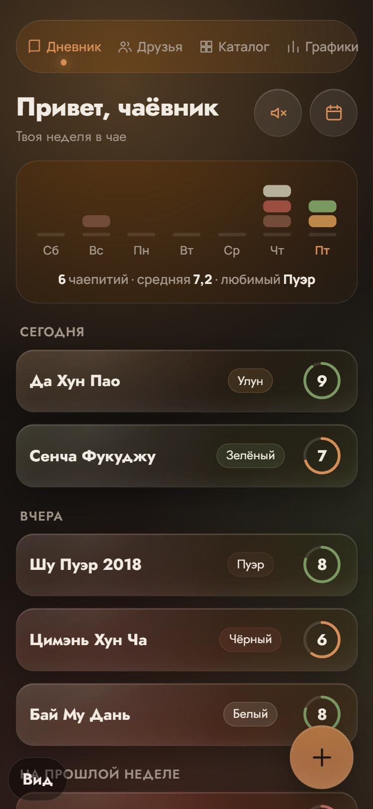
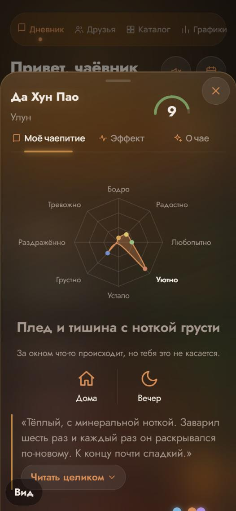
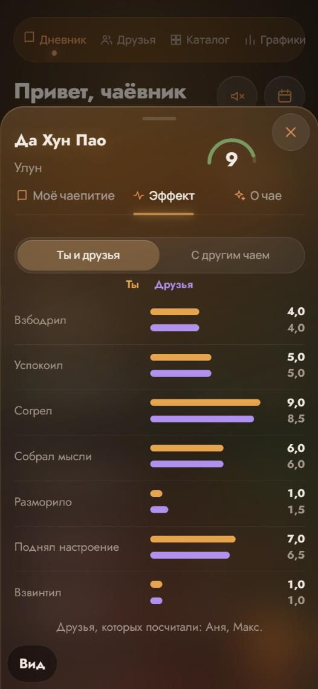
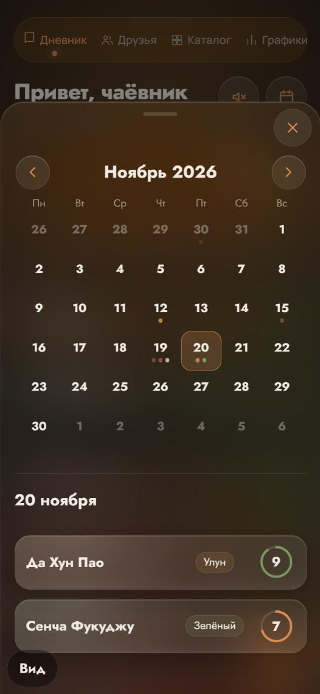
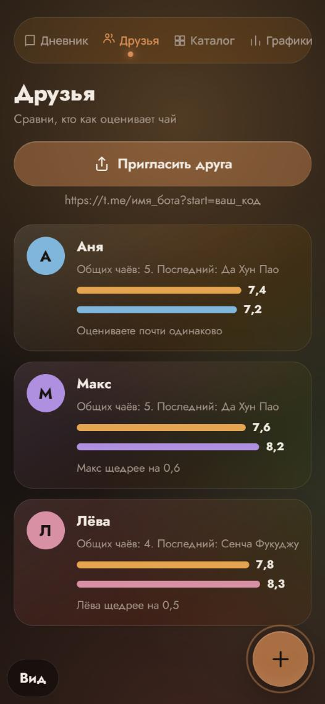
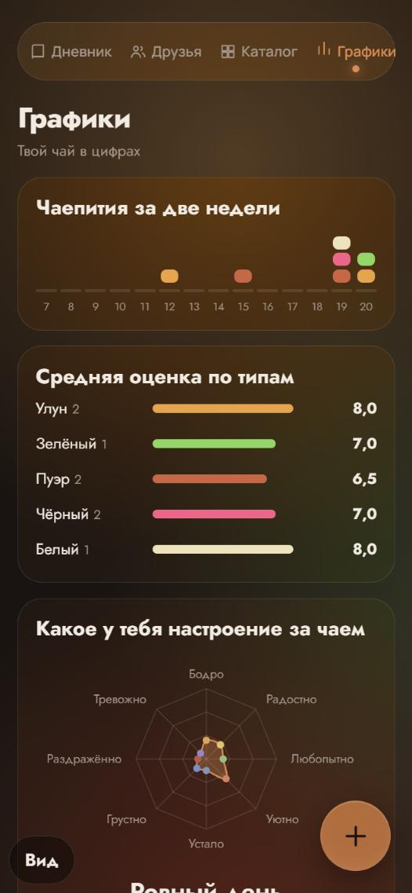
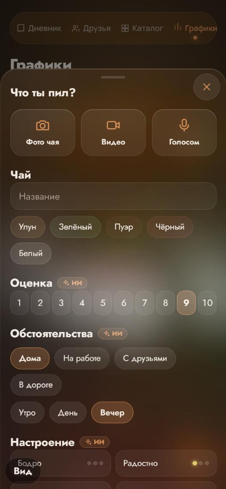

# Sip & Tell

Чайный дневник для друзей в виде Telegram Mini App. Записываешь чаепитие: какой чай, оценка, настроение, обстоятельства, как подействовал, свой отзыв. Друзья видят твои оценки, а ты сравниваешь их со своими. Ничего скачивать не нужно: бот открывает приложение кнопкой прямо в Telegram.

Первый круг только для друзей автора. Публичного запуска пока нет.

## Что умеет клиент

Клиент работает на тестовых данных, сервера в нём нет.

- **Дневник:** карточки чаепитий в цвет чая, группы «Сегодня», «Вчера», «На прошлой неделе», сводка недели, календарь с чашками по дням, свайп для правки и удаления.
- **Детали чаепития:** настроение радаром с живой анимацией, обстоятельства, отзыв, оценки друзей на одной шкале. Вкладки «Эффект» (как подействовал чай: твоя оценка и друзей, сравнение двух чаёв) и «О чае» (справка от ИИ).
- **Форма «Выпил»:** фото, видео или голос заполняют поля, поле от ИИ помечено значком, всё правится руками. Пока ответ ИИ имитируется.
- **Друзья, каталог, графики.**
- Вибрация и звук сохранения, кнопка «Назад» Telegram, пустые состояния.



| Детали | Эффект | Календарь |
|---|---|---|
|  |  |  |

| Друзья | Графики | Форма «Выпил» |
|---|---|---|
|  |  |  |

## Что умеет сервер

Каркас сервера лежит в отдельной ветке `feat/server`: проверка подписи Telegram, чаепития и каталог (чужие строки не отдаются), имитация ИИ, вебхук бота, который разбирает присланное и удаляет его из чата после успеха. Подробности в [docs/api.md](docs/api.md).

## Как запустить клиент

```bash
cd web
npm install
npm run dev
```

Открой адрес из вывода на телефоне или в браузере с размером окна около 375×812. Данные сохраняются в браузере.

## Стек

- Сервер: C#, ASP.NET Core на .NET 10, один процесс (клиент, API, вебхук бота), PostgreSQL.
- Клиент: React, TypeScript, Vite, `@twa-dev/sdk`, анимации на Motion, шрифты Jost и Manrope.

Состав первого круга обсуждается, см. [docs/PRODUCT.md](docs/PRODUCT.md). Решения по каждому элементу интерфейса в [docs/ELEMENTS.md](docs/ELEMENTS.md), идеи на потом в [docs/IDEAS.md](docs/IDEAS.md).

## Эксперимент

Проект ведётся как эксперимент в разделении ролей:

- Владелец выступает заказчиком: решает, как приложение выглядит и как работает, предлагает идеи.
- Claude (Claude Code) пишет весь код, тесты и документацию.
- Каждый экран сначала собирается в живом клиенте на тестовых данных, у каждого элемента несколько вариантов, владелец выбирает, остальные удаляются.
- Каждый шаг заканчивается проверкой: тестом или запуском.
- Коммиты мелкие, со смыслом, сделаны Claude.

Цель эксперимента: понять, можно ли довести рабочий продукт от идеи до друзей, не написав ни строки кода руками.

## Видео-презентация

Будет добавлена вместе с владельцем: видео загружается им как вложение GitHub, ссылка встанет сюда.

## История

Идеи пришли из архивного проекта Nightpour («Что я пью»). Автор перестал пить, а друзья заинтересовались чаем.
